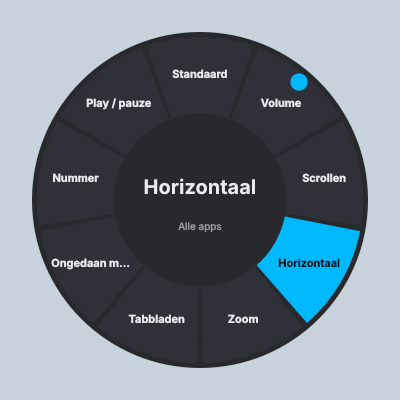

# Craft Crown

Een lichte vervanger voor Logi Options voor de **crown (draaiknop) van het Logitech Craft-toetsenbord**,
op **Windows en macOS** (Linux werkt ook grotendeels).

- Draaien, ingedrukt draaien, tikken en lang drukken koppel je aan acties.
- **Tik op de crown → er verschijnt een ring** op het scherm. Draai om een tool te kiezen, tik om ze
  te activeren. Daarna doet draaien wat die tool doet (zoom, tabbladen, penseelgrootte, …).
- Instellingen gelden **algemeen of per app**. De app op de voorgrond wordt automatisch herkend,
  en elke app onthoudt welke tool het laatst actief was.
- Een tray-/menubalk-icoon met een instellingenvenster (de "widget") om alles te beheren.



## Hoe het werkt

De Craft stuurt de crown standaard als gewone scroll- of volume-events. Logi Options zet de crown via
Logitech's **HID++ 2.0**-protocol (feature `0x4600 CROWN`) in *diverted* modus. Dan stuurt het
toetsenbord ruwe meldingen (rotatie, ratelklikjes, tik, indrukken) naar de software in plaats van naar
het OS. Craft Crown doet precies hetzelfde via `hidapi`, zowel via de Unifying-ontvanger als via
Bluetooth. Wanneer je de app afsluit, krijgt de crown haar normale gedrag terug.

> **Sluit Logi Options / Logi Options+ af** (en schakel het uit bij het opstarten). Twee programma's die
> tegelijk de crown overnemen, zitten elkaar in de weg.

## Installeren en starten

Je hebt Python 3.9 of nieuwer nodig.

```bash
git clone <deze repo> && cd LogitechCraft
python -m venv .venv
# Windows:  .venv\Scripts\activate      macOS:  source .venv/bin/activate
pip install -r requirements.txt
python craft_crown.py            # of: python -m craftcrown
```

Opties:

| Optie | Betekenis |
|---|---|
| `--settings` | open meteen het instellingenvenster |
| `--simulate` | geen Craft nodig: een venstertje met knoppen simuleert de crown (om de ring uit te proberen) |
| `--config PAD` | ander configuratiebestand gebruiken |
| `--background` | start zonder venster, alleen het icoon (voor automatisch starten) |
| `--selftest MAP` | controleer of de app werkt; resultaat en screenshots komen in MAP |
| `-v` | uitgebreide logging (handig bij problemen) |

Bij het starten opent het instellingenvenster, met bovenaan of de Craft gevonden is (en zo niet,
waarom). Open je de app nog eens terwijl ze al draait, dan komt dat venster naar voren.

### Als losse app (zonder Python)

**Kant-en-klaar downloaden:** GitHub Actions bouwt bij elke push automatisch de app.
Ga naar het tabblad **Actions** › de laatste run van *test-and-build* › onderaan bij **Artifacts**:
`CraftCrown-Windows.zip` (uitpakken en `CraftCrown.exe` starten) en `CraftCrown-macOS-arm64.zip`
(Apple Silicon, macOS 14 of nieuwer; bevat `CraftCrown.app`, alleen in de menubalk, zonder Dock-icoon). Elke build wordt op de runner ook echt gestart met `--selftest`; het
resultaat en screenshots staan in het artifact `selftest-…`. Je kunt een build ook met de hand
starten via *Run workflow*. Push je een tag zoals `v0.1.0`, dan komen beide zips in een
**GitHub Release**.

> macOS: de app is niet ondertekend. Open hem de eerste keer met rechtermuisklik › *Open*, of voer
> `xattr -dr com.apple.quarantine CraftCrown.app` uit. Windows SmartScreen: *Meer informatie* ›
> *Toch uitvoeren*.

Zelf bouwen: `pip install pyinstaller && pyinstaller craft_crown.spec`.

**Automatisch starten:** Windows: een snelkoppeling naar `CraftCrown.exe` in `shell:startup`.
macOS: Systeeminstellingen › Algemeen › Inloggen › Open bij inloggen › `CraftCrown.app`.

### macOS-machtigingen

Systeeminstellingen › Privacy en beveiliging:

- **Toegankelijkheid**: nodig voor zoom, scrollen en sneltoetsen (volume werkt ook zonder). De app
  vraagt dit zelf en toont een rode waarschuwing zolang het ontbreekt. **Na elke nieuwe versie**: haal
  Craft Crown weg uit de lijst (−), voeg hem opnieuw toe (+) en herstart; de app is niet ondertekend,
  dus macOS ziet elke build als een andere app. Geef dit aan
  Terminal/iTerm (als je vanuit Python start) of aan `CraftCrown.app`.
- **Invoerbewaking**: alleen nodig als macOS daarom vraagt bij het openen van het toetsenbord.

## Bediening

| Gebaar | Standaard | Met de ring open |
|---|---|---|
| Draaien | actie van de actieve tool, anders de *Draaien*-actie van het profiel (standaard: volume) | selectie verplaatsen |
| Ingedrukt draaien | *Ingedrukt draaien* (standaard: horizontaal scrollen) | selectie verplaatsen |
| Tikken | *Tikken* (standaard: **ring openen**) | gekozen tool activeren |
| Lang drukken | *Lang drukken* (standaard: afspelen/pauze) | ring sluiten zonder iets te wijzigen |

- Het eerste vak in de ring, **Standaard**, zet de crown terug op de gewone *Draaien*-actie.
- Een tool zonder draai-actie is een **knop-tool**. Kies je die in de ring, dan voert ze één keer haar
  *Bij kiezen*-actie uit (bv. "Play / pauze") en blijft de huidige tool actief.
- De ring sluit vanzelf na een paar seconden zonder input (in te stellen).

## Profielen per app

In het instellingenvenster (tray-icoon › *Instellingen…*):

1. **★ Alle apps (standaard)**: geldt overal.
2. **+ App**: kies een app die recent open stond, of vul ze zelf in. Een app wordt herkend aan
   - Windows: de naam van het programma, bv. `chrome.exe`, `Photoshop.exe`
   - macOS: de bundle-id, bv. `com.google.Chrome`, `com.adobe.Photoshop`

   Zet beide in hetzelfde profiel (komma-gescheiden). Dan werkt één profiel op beide systemen.
3. Elke actie van een app-profiel kan op **"Zoals standaardprofiel"** blijven staan. Vink
   **"Eigen ring"** aan om de app een eigen set tools te geven.

Meegeleverde voorbeelden: *Browsers* (scrollen, ingedrukt = tabbladen; ring met tabbladen, zoom,
geschiedenis), *Photoshop* (penseelgrootte, hardheid, zoom, geschiedenis, lagen) en *Excel*
(kolommen, werkbladen, zoom).

### Beschikbare acties

**Draaien:** volume · verticaal/horizontaal scrollen · zoomen · tabbladen wisselen · ongedaan
maken/opnieuw · pijltjestoetsen · page up/down · volgend/vorig nummer · eigen sneltoetsen (rechtsom/linksom).

**Tikken / lang drukken / bij kiezen:** ring openen · terug naar standaard · afspelen/pauze · dempen ·
volgend/vorig nummer · sneltoets · tekst typen · commando uitvoeren.

### Sneltoetsen schrijven

- `mod` = **Cmd** op macOS en **Ctrl** op Windows: `mod+shift+z`, `mod+=`, `mod+-`
- andere namen: `ctrl alt shift cmd tab enter esc space backspace delete up down left right home end
  page_up page_down f1…f20 media_play_pause media_next media_previous media_volume_up …`
- verschilt het per systeem, geef dan beide: `win=ctrl+y; mac=cmd+shift+z`

## Configuratiebestand

Alles wordt automatisch bewaard in `config.json`:

- Windows: `%APPDATA%\CraftCrown\config.json`
- macOS: `~/Library/Application Support/CraftCrown/config.json`
- Linux: `~/.config/CraftCrown/config.json`

Je kunt het ook met de hand aanpassen en daarna *Configuratie herladen* kiezen in het tray-menu.

```json
{
  "general": {"ring_timeout_ms": 4000, "long_press_ms": 500, "scroll_mode": "ratchet", "...": "..."},
  "default": {
    "rotate": {"type": "volume"},
    "rotate_pressed": {"type": "hscroll", "lines": 2},
    "tap": {"type": "ring"},
    "long_press": {"type": "play_pause"},
    "ring": [
      {"label": "Zoom", "rotate": {"type": "zoom"}},
      {"label": "Play / pauze", "rotate": null, "select": {"type": "play_pause"}}
    ]
  },
  "apps": [
    {"name": "Photoshop", "match": ["photoshop.exe", "com.adobe.Photoshop"],
     "rotate": {"type": "keys", "cw": "]", "ccw": "["},
     "rotate_pressed": null, "tap": null, "long_press": null, "ring": null}
  ]
}
```

`null` betekent: neem de waarde van het standaardprofiel over.

## Problemen oplossen

- **"Craft niet gevonden"**: staat Logi Options(+) nog aan? Op Linux heb je een udev-regel nodig voor
  toegang tot `/dev/hidraw*` (dezelfde als voor Solaar).
- **"in slaap of niet verbonden"**: druk een toets in. Het toetsenbord wordt wakker en de crown wordt
  automatisch opnieuw overgenomen.
- **Draaien doet te veel of te weinig**: kies onder *Algemeen › Gevoel van de crown* tussen ratel en
  vloeiend, of pas *Herhalingen per klik* of *Regels per klik* aan.
- **Sneltoetsen doen niets op macOS**: geef de Toegankelijkheid-machtiging (zie hierboven).
- Er wordt een logbestand bijgehouden naast `config.json` (`craftcrown.log`); open het via het
  menubalk-icoon › *Logbestand tonen*. Start met `-v` voor meer detail.

## Ontwikkeling

```bash
pip install -e ".[dev]"
pytest
```

| Bestand | Rol |
|---|---|
| `craftcrown/hidpp.py` | HID++ 2.0-berichten, crown-feature `0x4600`, decoderen van crown-events |
| `craftcrown/device.py` | achtergrondthread: ontvanger/Bluetooth zoeken, crown omleiden, watchdog/herverbinden |
| `craftcrown/controller.py` | state machine: draaien/tikken/lang drukken, ring, tool per app (zonder Qt, getest) |
| `craftcrown/actions.py`, `keys.py` | acties en sneltoetsen (pynput, Windows + macOS) |
| `craftcrown/activeapp.py` | voorgrond-app herkennen (Win32 API / NSWorkspace) |
| `craftcrown/config.py` | profielen, overerving, laden en bewaren |
| `craftcrown/ui/` | ring-overlay, HUD en instellingenvenster (PySide6) |

De byte-indeling van de crown-meldingen (rotatie, ratel, tik, indrukken) volgt de implementatie in
[Solaar](https://github.com/pwr-Solaar/Solaar).
